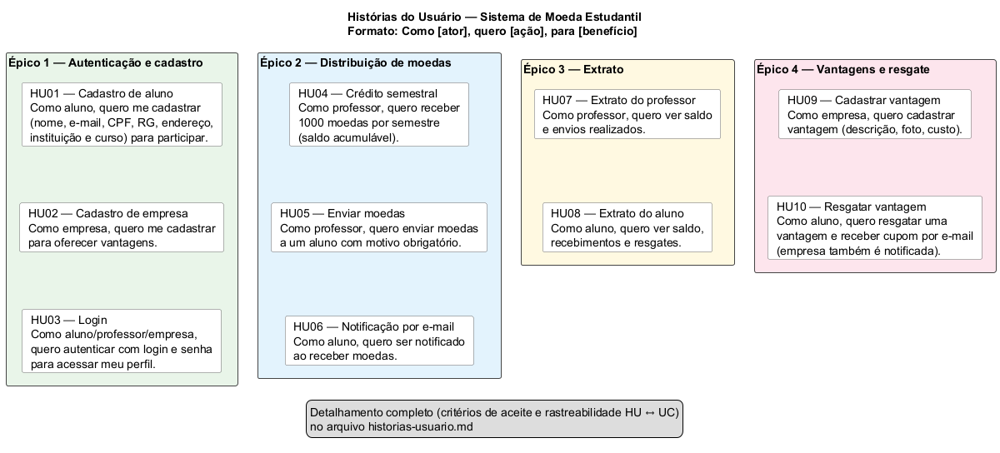
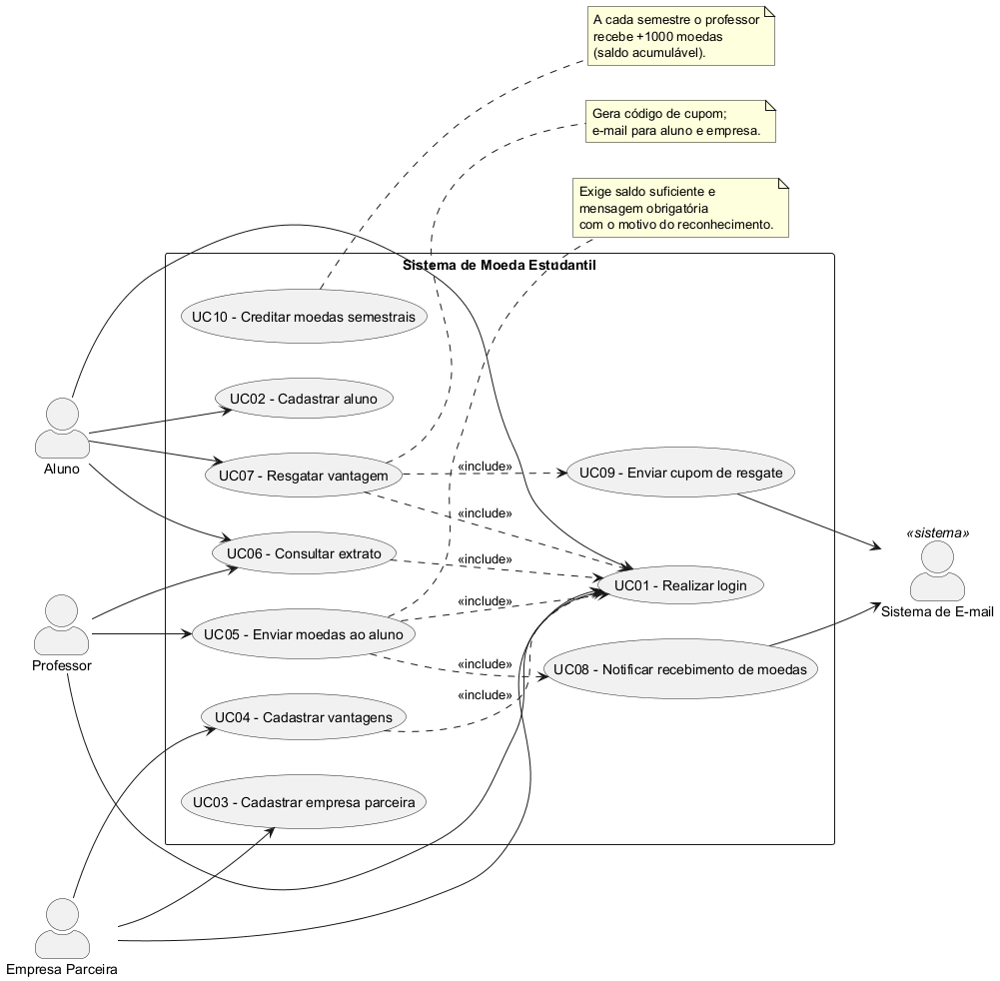
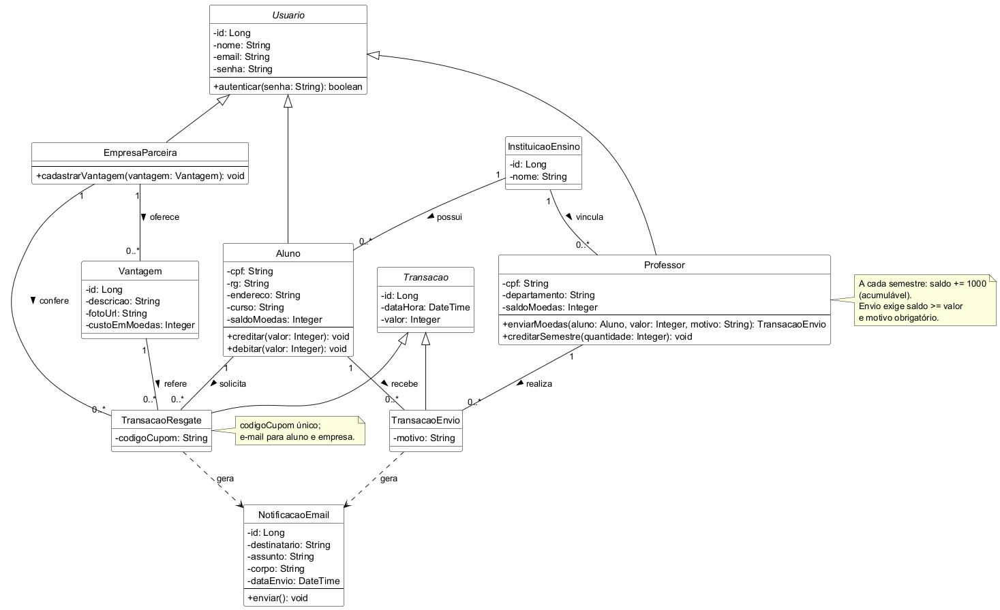
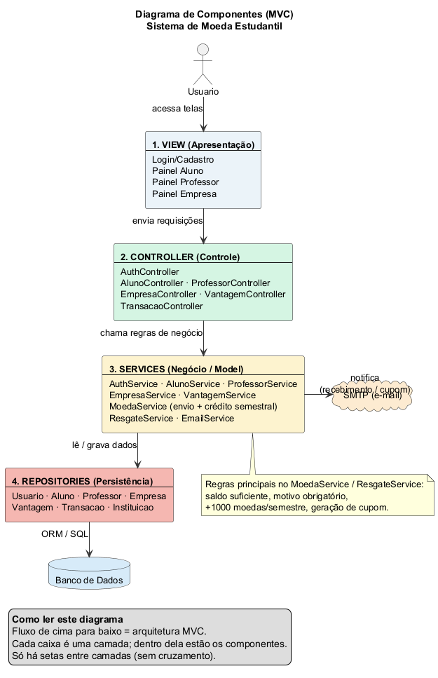

# Lab03S01 — Modelagem do sistema

Entrega da Sprint 1 conforme o enunciado do Laboratório 3.

## Artefatos

1. **Diagrama de Casos de Uso** — [`diagrama-casos-de-uso.puml`](diagrama-casos-de-uso.puml) · [PNG](images/diagrama-casos-de-uso.png)
2. **Histórias do Usuário** — [`historias-usuario.md`](historias-usuario.md) · [PNG](images/historias-usuario.png) · [`.puml`](historias-usuario.puml)
3. **Diagrama de Classes** — [`diagrama-classes.puml`](diagrama-classes.puml) · [PNG](images/diagrama-classes.png)
4. **Diagrama de Componentes** — [`diagrama-componentes.puml`](diagrama-componentes.puml) · [PNG](images/diagrama-componentes.png)

## Histórias do Usuário

Visão geral (épicos e HUs). Detalhes e critérios de aceite em [`historias-usuario.md`](historias-usuario.md).



| ID | História | Ator |
|----|----------|------|
| HU01 | Cadastro de aluno | Aluno |
| HU02 | Cadastro de empresa parceira | Empresa |
| HU03 | Login no sistema | Aluno / Professor / Empresa |
| HU04 | Crédito semestral de moedas | Professor |
| HU05 | Enviar moedas a um aluno | Professor |
| HU06 | Notificação de recebimento | Aluno |
| HU07 | Consultar extrato (professor) | Professor |
| HU08 | Consultar extrato (aluno) | Aluno |
| HU09 | Cadastrar vantagem | Empresa |
| HU10 | Resgatar vantagem | Aluno |

## Diagramas (PNG)

### Casos de Uso



### Classes



### Componentes (MVC)

Fluxo de cima para baixo: View → Controller → Services → Repositories → Banco.



## Como regenerar as imagens

```powershell
java -jar .\.tools\plantuml.jar -tpng -charset UTF-8 -o "$PWD\docs\sprint1\images" docs\sprint1\*.puml
```

## Atores principais

| Ator | Responsabilidades |
|------|-------------------|
| Aluno | Cadastro, extrato, resgate de vantagens |
| Professor | Envio de moedas, extrato, crédito semestral |
| Empresa Parceira | Cadastro, cadastro de vantagens |
| Sistema de E-mail | Notificações de recebimento e cupom |

## Próxima sprint (Lab03S02)

Modelo ER, estratégia de acesso ao BD e CRUDs iniciais de aluno e empresa.
